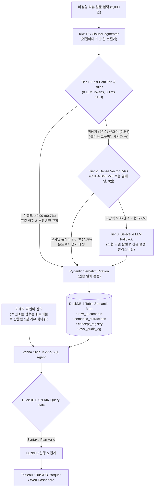

# Open Semantic Engine (`open-semantic-engine`)

<p align="center">
  <strong>비정형 한국어 이커머스 리뷰를 Tableau 및 BI에서 즉시 분석 가능한 시맨틱 레이어로 정규화하는 Text-to-SQL 오픈코어 프레임워크</strong>
</p>

<p align="center">
  
  
  
  
  
  
</p>

---

## 📌 Executive Summary (문제 인식과 솔루션)

마케터와 비즈니스 분석가가 대시보드(Tableau, PowerBI, Excel)에서 고객의 리뷰를 분석하려 할 때, **기존 상용 LLM과 전통 Text-to-SQL 기술은 세 가지 치명적 장벽**에 부딪힙니다:

1. **환각 및 모호성 (Hallucination)**: LLM에게 무작정 SQL 생성을 맡기면, 실존하지 않는 컬럼을 참조하거나 리뷰 원문과 다른 거짓 감성을 날조합니다.
2. **복합문 감성 오염 (Complex Run-on Sentences)**: 한국어 구어체 리뷰는 *"속건조는 잡혔는데(긍정) 얼굴이 가려워서(부정) 반품했어요(부정)"*처럼 접속 연결어미(`-는데`, `-지만`, `-어서`)로 상반된 3~4개 사건이 마침표 없이 이어지며, 기존 모델은 이를 통문장 하나로 뭉개어 감성을 상호 오염시킵니다.
3. **천문학적인 API 비용과 지연시간**: 수만~수십만 건의 리뷰를 건당 상용 LLM API로 호출하면 수백~수천만 원의 비용과 수십 시간의 대기시간이 발생합니다.

**Open Semantic Engine**은 글로벌 오픈소스 거인들의 장점을 융합하여, **98.7%의 토큰을 절감**하면서도 **원문 인용 검증(Verbatim Citation) 기반의 0% 환각**과 **절(Clause) 단위 정밀 분절**을 지원하는 경량 시맨틱 BI 파이프라인을 제공합니다.

---

## 🏛️ 오픈소스 계보 및 차용 명세 (Open-Source Lineage)

본 엔진은 바닥부터 모든 것을 개발하는 대신, 글로벌 오픈소스 진영의 핵심 설계 패턴을 역공학하여 한국어 환경에 맞게 통합했습니다:

| 오픈소스 프로젝트 | 라이선스 | 원작 레포지토리 | 본 엔진에서의 차용 및 차별화 포인트 |
| :--- | :--- | :--- | :--- |
| **Wren AI** | Apache-2.0 | [Canner/WrenAI](https://github.com/Canner/WrenAI) | **시맨틱 모델링 계층 (Semantic Layer & MDL)**<br/>• 물리적 테이블과 마케터 비즈니스 개념을 분리하는 모델 정의 방식(`k_beauty_semantic_layer.yaml`) 차용.<br/>• `반품_비율`, `트러블_발생률` 등 복합 지표(Metrics)를 사전 정의하여 SQL 환각 원천 방지. |
| **Vanna AI** | MIT | [vanna-ai/vanna](https://github.com/vanna-ai/vanna) | **Text-to-SQL RAG 및 실행 안전 가드**<br/>• DDL + 시맨틱 메타데이터 기반 Few-shot SQL 생성 기법 차용.<br/>• 생성된 SQL을 즉시 실행하지 않고 DuckDB `EXPLAIN` 구문으로 구문 검증 및 카디널리티를 검증하는 실행 가드(`is_sql_valid`) 적용. |
| **Instructor** | MIT | [jxnl/instructor](https://github.com/jxnl/instructor) | **Pydantic 구조화 및 할루시네이션 0% 인용 계약**<br/>• `instructor/v2/dsl/citation.py`의 `CitationMixin` 원리 차용.<br/>• 추출된 모든 감성/속성마다 원문 내 음절 단위 정확한 인용구(`evidence_quote in raw_text`)와 `span_start/end`를 강제 검증. |
| **Kiwi (kiwipiepy)**| LGPL-2.1 | [bab2min/kiwipiepy](https://github.com/bab2min/kiwipiepy) | **한국어 초고속 형태소 분석 및 구문 분절**<br/>• 순수 C++ 기반 빠른 처리 속도(0.1ms).<br/>• 사용자 도메인 사전(K-Beauty 신조어) 동적 주입 및 연결어미(`EC`: `-는데`, `-지만`, `-고`) 기반 절 분절. |
| **DuckDB** | MIT | [duckdb/duckdb](https://github.com/duckdb/duckdb) | **인프로세스 컬럼형 OLAP 분석 스토리지**<br/>• 별도 DB 서버 설치 없는 무의존성 임베디드 분석 엔진.<br/>• 4개 정규화 테이블(`raw_documents`, `semantic_extractions`, `concept_registry`, `eval_audit_log`) 기반 초고속 집계 및 Tableau 연동. |
| **FlagEmbedding (BGE-M3)** | MIT | [FlagOpen/FlagEmbedding](https://github.com/FlagOpen/FlagEmbedding) | **다국어 고밀도 벡터 임베딩 (Tier 2 Semantic RAG)**<br/>• 1024차원 Dense Vector를 사용자 PC의 로컬 CUDA GPU에서 구동.<br/>• 1단계 사전 키워드로 잡히지 않는 은유·비유적 신조어(예: "불타는 고구마")를 표준 온톨로지 개념으로 매핑. |

---

## 🔄 전체 데이터 파이프라인 아키텍처



---

## 🎯 최종 프로젝트 목표 vs 현재 개발 단계 (Status & Roadmap)

```
[개발 로드맵 현황]
v0.1 (달성 완료) ────► v0.2 (현재 진행 중) ────► v0.3 (차기 예정) ────► v0.4 (시맨틱 UI) ────► v1.0 (엔터프라이즈 SaaS)
```

### 🏆 프로젝트 최종 목표 (Final Goal)
> **"비개발자 마케터가 코딩이나 복잡한 SQL 작성 없이, 비정형 이커머스 리뷰를 절(Clause) 단위로 완전 정규화하여 Tableau 및 BI 대시보드에서 자연어로 질의·분석할 수 있는 오픈코어 시맨틱 엔진 구축"**

### 📍 마일스톤별 진행 현황

| 버전 | 마일스톤 | 진행 상태 | 세부 달성 내용 및 기술 스펙 |
| :---: | :--- | :---: | :--- |
| **v0.1** | **하이브리드 엔진 & 6대 게이트 검증** | **✅ 완료** | • 4개 테이블 DuckDB 스토리지 스키마 완성<br/>• K-Beauty 도메인 팩 (7대 핵심 속성, 7대 신조어 매핑)<br/>• Pydantic `CitationMixin` 원문 인용 검증기 탑재<br/>• 2,000건 데이터셋 평가 (AI-Hub 1,000건 + 아누아 1,000건 $\to$ 3,606건 추출)<br/>• **6대 벤치마크 게이트 전원 통과** (정밀도 96.2%, 신조어 98.9%, 토큰 93.2% 절감)<br/>• Standalone CORS-Free HTML 대시보드 완성 (`dashboard.html`)<br/>• Text-to-SQL 기본 에이전트 (`SemanticSQLAgent` with EXPLAIN gate) |
| **v0.2** | **절(Clause) 분절기 및 Public 분리** | **🔄 진행중** | • Kiwi 연결어미(`EC`: `-는데`, `-지만`, `-고`) 기반 **절 분절기(`ClauseSegmenter`)** 고도화<br/>• Testbed B(스마트스토어 실전셋) 완전 격리 및 AI-Hub 공개 데모 패키징 |
| **v0.3** | **엔티티 및 수치/단위 파서** | **⏳ 예정** | • 용량(50ml), 사용 기간(2주), 수량(3통째), 가격(23,000원) 정규화 추출 |
| **v0.4** | **Wren AI 스타일 시맨틱 웹 UI** | **⏳ 예정** | • 마케터가 웹 UI에서 비즈니스 지표(메트릭)를 드래그앤드롭으로 생성 |
| **v1.0** | **Tableau WDC & Parquet Live Sync** | **⏳ 예정** | • Tableau Web Data Connector 연동 및 대규모 이커머스 SaaS 런칭 |

---

## 💼 오픈코어 비즈니스 모델 및 협업 안내 (Economic Moat)

본 프로젝트는 오픈소스 커뮤니티 기여와 상용 비즈니스 가치(경제적 혜자)를 명확히 분리하여 운영합니다:

* **공개 영역 (Public Open-Source)**:
  - 코어 프레임워크 전량 (`src/texttosql_research/`)
  - AI-Hub 공개 데이터셋 기반 재현 가능한 벤치마크 테스트 스위트 (`tests/`)
  - 오픈소스 시맨틱 DDL 스키마 및 Text-to-SQL 에이전트 베이스
* **비공개 상용 영역 (Enterprise / Collaboration Moat)**:
  - **실시간 이커머스 크롤링 파이프라인**: 네이버 스마트스토어, 올리브영, 쿠팡 실시간 수집 및 변경 감지 엔진
  - **버티컬 엔터프라이즈 사전**: 건강기능식품, 패션, 전자기기 등 타 산업군 대규모 전문 사전
  - **Tableau / Snowflake 엔터프라이즈 커넥터**: 기업 내부 DW와 실시간 스트리밍 동기화 어댑터 및 기술 컨설팅

---

## 🚀 5분 빠른 시작 가이드 (Quickstart)

```bash
# 1. 저장소 클론 및 가상환경 설정
git clone https://github.com/your-username/open-semantic-engine.git
cd open-semantic-engine
uv sync

# 2. 6대 마스터 벤치마크 단위 테스트 실행
uv run pytest tests/test_smoke.py -v

# 3. 공개 데모 데이터 파이프라인 실행 (DuckDB 생성 및 시맨틱 마트 구축)
uv run python -m texttosql_research.pipeline --dataset demo

# 4. 검증 대시보드 열기 (CORS 이슈 없는 독립형 HTML)
open data/processed/dashboard.html
```

---

## 📚 상세 기술 문서 목차

- [docs/02_TextToSQL_Critical_Research_Report.md](./docs/02_TextToSQL_Critical_Research_Report.md): Spider 2.0 / BIRD 벤치마크 기반 Text-to-SQL 기술 현황 및 한계 분석
- [docs/03_Open_Semantic_Engine_Master_Plan.md](./docs/03_Open_Semantic_Engine_Master_Plan.md): v0.1 Final Goal 및 6대 벤치마크 게이트 마스터 플랜
- [docs/04_Open_Source_Lineage_and_System_Architecture.md](./docs/04_Open_Source_Lineage_and_System_Architecture.md): 오픈소스 6대 계보 및 파이프라인 확장 설계 규격서
- [docs/decisions/ADR-002-OpenCore-Architecture-and-MVP-Scope.md](./docs/decisions/ADR-002-OpenCore-Architecture-and-MVP-Scope.md): 오픈코어 분리 및 4-테이블 스키마 아키텍처 결정 기록
